## Reporting issues

OpenTAXII uses Github's issue tracker. See the [OpenTAXII project page](https://github.com/MISP/OpenTAXII) on Github.

## Obtaining the source code

The OpenTAXII source code can be found on Github. See the [OpenTAXII project page](https://github.com/MISP/OpenTAXII).

## Layout

OpenTAXII repository has the following layout:

-   `docker/` - Docker configuration files ([OpenTAXII Docker documentation](../installation/docker.qmd));
-   `docs/` - used to build the [documentation](https://misp.github.io/OpenTAXII/);
-   `examples/` - configuration and code examples;
-   `opentaxii/` - OpenTAXII source;
-   `tests/` - opentaxii tests.

## Database schema

The built-in SQL backends define separate schemas for TAXII 2.1, TAXII 1.x, and accounts. The diagrams show selected columns and database foreign keys. A circle at the parent end indicates that the foreign key can be null. `PK`, `FK`, and `UK` mark primary, foreign, and unique keys.

### TAXII 2.1

API roots organize collections and track object submissions. A collection can store multiple versions of the same STIX object. The database enforces uniqueness for `(collection_id, id, version)` on STIX objects and `(api_root_id, alias)` on collections. Job details record submission results by STIX ID and version.

{fig-alt="A TAXII 2.1 entity-relationship diagram. API roots link to collections and jobs. Collections link to stored STIX objects, and jobs link to job details."}

### TAXII 1.x

Join tables associate services with collections and collections with content blocks. Inbox messages may supply content blocks, and collections are referenced by poll result sets and subscriptions.

{fig-alt="A TAXII 1.x entity-relationship diagram with two join tables. Services and content blocks link to data collections through their respective join tables."}

### Accounts

The SQL authentication backend stores permissions as JSON in the `_permissions` column. OpenTAXII checks collection access using the collection name for TAXII 1.x and the collection ID for TAXII 2.1.

{fig-alt="The standalone accounts table has a primary key on id and a unique key on username."}

### Updating the diagrams

Edit the Mermaid sources in `docs/assets/diagrams/` and regenerate the SVGs with Quarto 1.9.38, Python Playwright, and Chromium installed. Commit the sources and SVGs together so the HTML, PDF, and EPUB builds can use the artwork directly. [MISP book diagram template](https://github.com/MISP/misp-book/tree/68e2dfc4893db0143bd91a8fb6ff2d6a52f65f18/assets/diagrams)

``` sh
uv run --with playwright --no-project python docs/update_db_schema_diagram.py \
  --mermaid-js /path/to/quarto/share/formats/html/mermaid/mermaid.min.js \
  --chromium /usr/bin/chromium
```

The embedded MISP logo is by the MISP contributors and is licensed under CC BY 4.0. [Logo and attribution](https://github.com/MISP/MISP/blob/99ebee729702c560528f9788953719bda68aa1c1/INSTALL/logos/README.md)

## Set up a development environment

Install uv as described in the [installation guide](../installation/installation.qmd#install-with-uv). From the repository root, create a virtual environment and install an editable copy of OpenTAXII with its development dependencies.

``` sh
uv venv --python 3.11
uv pip install -r requirements-dev.txt -e .
```

OpenTAXII's package metadata lives in `setup.py`. Use `uv run --no-project` to run commands in `.venv` with the installed package.

## Running the tests

Run the test suite from the repository root. It uses temporary SQLite databases by default.

``` sh
uv run --no-project python -m pytest
```

The CI matrix in `tox.ini` also tests against MySQL, MariaDB, and PostgreSQL.

### MISP feed round trip

This test converts two saved MISP events to STIX 2.1 with `misp-stix`. It uses `misp-cabby` to upload them over HTTPS to a local OpenTAXII server, then checks the submission status and compares all objects retrieved across multiple pages with the converted bundle. The client and server use the same `misp-libtaxii` installation. [CIRCL OSINT feed](https://www.circl.lu/doc/misp/feed-osint/)

``` sh
uvx --python 3.12 tox -e py312-feed-round-trip
```

GitHub Actions runs this test with a temporary SQLite database.

## Generating the documentation

The documentation is written in Quarto Markdown and built with [Quarto](https://quarto.org/). From the repository root, install the documentation dependencies and render the book.

``` sh
uv pip install -r docs/requirements.txt
uv run --no-project python docs/render-references.py
quarto render docs
```

Quarto writes the HTML, PDF, and EPUB to `docs/_book/`. Run `quarto preview docs` for a local preview.

GitHub Actions builds the book for pull requests and publishes it to [GitHub Pages](https://misp.github.io/OpenTAXII/) from `master`.

### Next steps

Continue to [License](../license.qmd).
